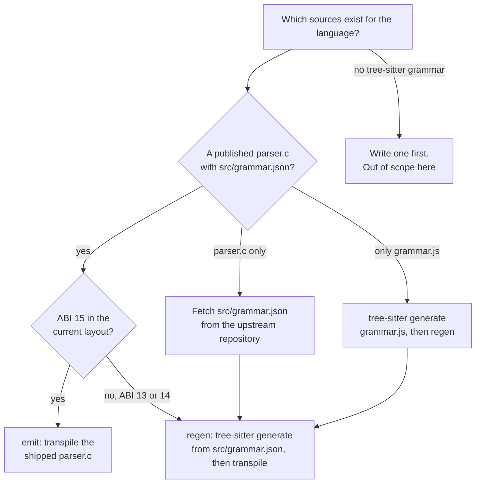

# Adding a language

This guide explains how to add a language to `tree-sitter-grammars-rs`, starting from the question
that decides everything else: **what do you already have for that language?** A published C grammar
turns the job into a transpile plus a scanner port. A grammar that only exists as `grammar.js`
needs one more step. A language with no tree-sitter grammar at all is a grammar-writing project
first, and this crate is not where that happens.

Everything below was learned porting more than forty grammars, so the pitfalls listed are real
ones. The checklist in [`CONTRIBUTING.md`](../CONTRIBUTING.md) is the short form; the agent brief in
[`tools/AGENT_BRIEF.md`](../tools/AGENT_BRIEF.md) is the same process written for an automated
worker.

## How the crate gets a grammar

A tree-sitter grammar compiles to a `parser.c`: parse tables, a lexer function, and optionally an
**external scanner** (`scanner.c`) for the tokens a lexer cannot express, such as indentation,
heredocs or nested string delimiters. This crate never compiles any C. Instead:

- [`c2rs`](https://github.com/aovestdipaperino/c2rs) transpiles `parser.c` (tables and lexers) into
  `src/<name>/parser.rs`. That file is generated; nobody edits it.
- An external scanner is **ported by hand** to `src/<name>/scanner.rs`, keeping the C's control
  flow and the exact bytes it serializes.
- Both are then compared with the original C by the c2rs differential harness. A port is done when
  that comparison reports 0 mismatches, not when it compiles.

## What do you have?



**A published crate with `parser.c` and `src/grammar.json`.** This is the common case and almost all
of the crate's grammars. Look at the `LANGUAGE_VERSION` define near the top of `parser.c`. If it is
15 and the file was produced by a recent generator, `c2rs` reads it directly (the `emit` path in
`tools/regen.sh`). If it is 13 or 14, or `c2rs` rejects the layout, regenerate it with the
`tree-sitter` CLI at ABI 15 from the resolved `src/grammar.json` (the `regen` path). The JSON is the
whole grammar with every `require` and `inherits` already resolved, so no node or npm is needed.

**A vendored `parser.c` with no `grammar.json`.** Some grammars were copied into another project
without their JSON. Find the upstream repository and the exact version or commit the copy came from
(a README, a `package.json`, the history of the project that vendored it), check out that version
and take `src/grammar.json` from it. Then confirm your regenerated parser is the same grammar as the
one you were given: same symbol list, same state, token and field counts. Keep the small files
`regen` needs under `tools/vendored/<name>-<version>/` so the result stays reproducible. The
dockerfile, protobuf and quint grammars were done this way.

**Only `grammar.js`.** Run `tree-sitter generate --abi 15` in the upstream checkout. It writes
`src/parser.c` and `src/grammar.json`; from there it is the previous case. This is the one situation
that needs node, and only when `grammar.js` pulls in npm dependencies. Prefer a released version of
the grammar over the repository's head: head can contain grammar changes that have not been
released, and downstream tests were written against the release.

**No grammar anywhere.** Writing a tree-sitter grammar is a separate project with its own tooling
and corpus. Do that upstream, release it, and then come back with a published `parser.c`.

## Does it have an external scanner?

Check `externals` in `src/grammar.json`, or look for `scanner.c` next to `parser.c`.

- **No scanner** (go, java, zig, pascal, objc, glsl and others): nothing to port. The module is the
  transpiled parser and a `mod.rs`.
- **A C scanner**: port it by hand. Every scanner so far has been plain C. A scanner written in C++
  has not come up yet, and would need its own care.
- **A scanner that includes shared code**: the ocaml, fsharp and php scanners include a header
  from a `common/` directory. Port what the scanner actually executes, and give the harness the
  include path (`C_INC` in `tools/verify.sh`).

Rules for a scanner port, each of which exists because a grammar needed it:

1. **Same control flow, same integer widths.** Use `wrapping_*` where a C `uint8_t` or `uint16_t`
   counter can wrap. The scanner's `gotos` become small functions that call each other in the C's
   order.
2. **Serialized bytes must be identical** to the C: layout, endianness and length. The incremental
   parser stores this state in the tree, and the harness compares it.
3. **Locale functions are ASCII.** `iswspace`, `iswalpha`, `iswalnum`, `iswdigit`, `iswlower`,
   `towupper` and friends behave as the C locale, which is what an embedded parser sees. Port them
   as ASCII ranges and list each use in the pull request. Never guess Unicode behaviour.
4. **Do not copy a buffer overrun.** A few C scanners can write one byte past the serialization
   buffer on deeply nested input. Check the real bound instead; the result is unchanged wherever the
   C stays in bounds. Say so in a comment.
5. **An `assert` that only fires on corrupt input** can be a `debug_assert!`.
6. **Signed `char`.** Where the C stores bytes in a `char` and compares them with a lookahead, port
   the signedness the C has on the platforms that matter (signed), and mention it.

## Tooling

| Tool | What it does |
|---|---|
| `tree-sitter` CLI (0.26.x) | regenerates `parser.c` at ABI 15 from `grammar.json` |
| `c2rs` | transpiles `parser.c` to Rust; `cargo install tree-sitter-c2rs` |
| `tools/register.py` | registers the language in `Cargo.toml`, `src/lib.rs`, `regen.sh`, `verify.sh` |
| `tools/regen.sh` | reproduces every `parser.rs`; `ONLY="name" tools/regen.sh <c2rs>` does one |
| `tools/verify.sh`, `c2rs/run.sh` | the differential check against the original C |

## The process

1. **Make a working copy.** Use a git worktree and a private copy of the c2rs harness, because the
   harness writes into its own directory and two runs at once will collide.
2. **Get the source** as described above and note exactly which crate version or commit it is.
3. **Transpile.** Drop the generated `abi.rs`, set the header to `Generated by c2rs. Do not edit.`,
   run `rustfmt --edition 2024`. Check the symbol `parser.c` exports: when it is not
   `tree_sitter_<name>` (dart exports `tree_sitter_dart_orchard`) pass the export name.
4. **Port the scanner** if there is one, under the rules above.
5. **Write `src/<name>/mod.rs`**: a `LANGUAGE` constant and every data constant the upstream crate
   exports, under the same names. Copy `node-types.json` and the queries into `data/<name>/`, and
   the upstream `LICENSE` next to them.
6. **Register it** with `tools/register.py <name> --tier medium|full --const <CONST> --crate <dir>
   --mode emit|regen [--subdir ...] [--srcdir ...] [--export ...]`. It is idempotent.
7. **Verify against the C** with the c2rs harness:

   ```
   LITE_DIR=<work dir> PREGEN=<dir with abi.rs and parser.rs> RS_SCANNER=<scanner.rs, if any> \
   DIRECT=1 GOLDEN=<file> SOUP=8000 FUZZ=10 PREFIX=12 INCR=5 \
   $C2RS/run.sh <harness name> <C src dir> <corpus dir or -> - <ext>
   ```

   It compares every table, calls the C and Rust lexers and scanners directly on a mock lexer for
   every state, parses the corpus, every prefix of it, incremental edits, thousands of random
   sentences built from the grammar's own tokens, and fuzzed mutants. The corpus is the upstream
   `test/corpus` at the matching tag; without one you rely on the soup, fuzz and direct checks, and
   should say so. The run must end `RESULT: PASS` with 0 mismatches.
8. **Add the tests.** `tests/<name>.rs` has a smoke parse that exercises the scanner, the golden
   trees recorded from the C (`tests/golden/<name>.golden`, more than 150 cases) and a check that
   every bundled query compiles.
9. **Run the gates.** `cargo fmt --all`, `cargo clippy --all-targets -- -D warnings`,
   `cargo test --release`, and `cargo build --no-default-features --features lang-<name>` so the
   language builds alone.
10. **Check reproducibility.** `ONLY="<name>" tools/regen.sh <c2rs>` must give back the `parser.rs`
    you are committing, byte for byte.

## Pitfalls that cost time

- **ABI 13 and 14 crates** look fine until `c2rs` rejects them. Regenerate instead of fighting it.
- **`parser.c` outside `src/`.** The legacy BASIC grammars keep it in `grammar-src/`, and ocaml,
  php and typescript keep several grammars in subdirectories. `register.py` has `--srcdir` and
  `--subdir` for these.
- **A different export symbol** from the module name: `--export <suffix>`.
- **A grammar with no fields** has a NULL `field_names` table. The harness used to crash on it; the
  current c2rs does not.
- **A regenerated `array.h`** from tree-sitter CLI 0.26 evaluates its argument several times in
  `array_delete`, which crashes the C reference of any scanner that calls
  `array_delete(&array_pop(...))` (php). `regen.sh` keeps the crate's own `array.h`.
- **Licences.** Some crates ship no `LICENSE` file. Fetch it from the upstream repository
  (`gh api repos/<owner>/<repo>/license --jq .content | base64 -d`) and add the notice to
  `THIRD_PARTY_LICENSES.md`.
- **Size.** Generated parsers are large: a few MB of Rust for a small grammar, tens of MB for the
  big ones. Check the packaged size before publishing, because crates.io limits a crate to 10 MB.

## Which tier?

`lite` is for the grammars most users need and is on by default. `medium` and `full` follow the
tiers of the C-based grammar crates this one replaces, so a consumer can swap one for the other.
Every language also has its own `lang-<name>` feature, so a tier is only a convenience.
